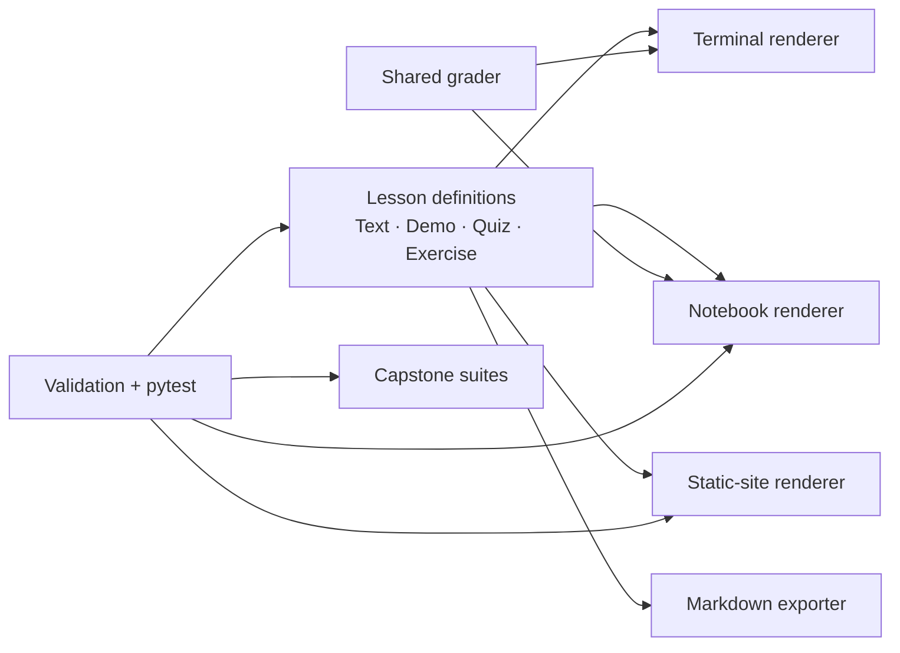

# Advanced Python Lab

> Go beyond Python syntax. Learn how Python actually works by building with its data model, descriptors, metaclasses, concurrency primitives, asyncio, bytecode, and AST.

[](https://www.python.org/)
[](https://github.com/sumilk/Python_tutorial/actions/workflows/pages.yml)
[](LICENSE)

**22 lessons · 33 graded exercises · 45 quiz questions · 5 capstone projects · 700+ automated tests**

[**Read the interactive course →**](https://sumilk.github.io/Python_tutorial/) · [**Browse the notebooks →**](https://github.com/sumilk/Python_tutorial/tree/main/notebooks) · [**Start here →**](https://github.com/sumilk/Python_tutorial/blob/main/notebooks/00-START-HERE.ipynb)

---

## This is not a beginner Python course

This course is for people who already know functions, classes, collections, modules, and ordinary Python application development — and now want to understand the machinery underneath them.

You will work through the parts of Python that stop being obvious:

- why methods bind `self`
- how descriptors power properties, methods, `__slots__`, and ORM fields
- how C3 linearization and cooperative `super()` actually work
- what metaclasses and `__init_subclass__` do during class creation
- how generators, coroutines, threads, processes, and asyncio differ
- what the GIL does — and does not — guarantee
- how imports, reference counting, cyclic GC, bytecode, and the AST fit together
- how to test code whose behavior depends on Python's runtime protocols

The emphasis is **hands-on understanding**, not memorizing syntax.

## What you will build

The five capstones combine multiple lessons into small systems with real pytest contracts.

| Project | What you build | Core ideas |
|---|---|---|
| **TinyORM** | Declarative models and a lazy query layer | descriptors, metaclasses, data model, typing |
| **Scheduler** | Async DAG runner with retries and cancellation | asyncio, structured concurrency, exceptions |
| **Lintly** | Pluggable AST linter with `# noqa` support | AST, imports, metaprogramming |
| **Resilient** | Retry, circuit breaker, token bucket, bulkhead | decorators, context managers, concurrency |
| **Streamz** | Lazy single-pass streaming pipeline with 16 operators | iterators, generators, functional tools |

Each project ships with a brief, an intentionally incomplete starter, a grading suite, and a reference solution used by the repository's own meta-tests.

```bash
uv run learn.py projects
uv run learn.py projects show tinyorm
uv run learn.py projects test tinyorm
```

## Built like software, not a pile of notebooks

Everything is authored once as structured lesson data and rendered into multiple learning experiences. The grader and validation logic are shared, so the front-ends cannot silently drift apart.



That design gives the course a few useful guarantees:

- every runnable demo is executed by the test suite
- every “predict the output” answer is compared with what Python actually prints
- every exercise reference solution must pass its own checks
- every untouched exercise starter must fail at least one check
- every capstone reference implementation must pass the learner-facing pytest suite
- generated notebooks and Markdown stay synchronized with the source curriculum
- GitHub Pages deploys only after the validation suite succeeds

## Quick start

No manual environment setup is required. `uv` provisions Python 3.12 and the development dependencies on first run.

```bash
git clone https://github.com/sumilk/Python_tutorial
cd Python_tutorial

uv run learn.py                 # interactive terminal course
uv run learn.py notebooks       # generate/open notebooks
uv run learn.py site            # build site/index.html
uv run pytest                   # validate the course
```

To work in Jupyter:

```bash
uv run --with jupyterlab jupyter lab notebooks/
```

## Learn it three ways

### 1. Jupyter notebooks — recommended

There is one notebook per lesson. Prose becomes Markdown, demos become runnable cells, and each exercise is followed by a grading cell.

```python
check("09-descriptors/validated-field")
# ✓ stores and retrieves per instance
# ✓ type checking, with the int/float and bool rules
# ✗ validation order: type before range — expected TypeError
```

Hints and reference solutions live in collapsed `<details>` blocks.

Regenerating notebooks protects learner work: an edited notebook is skipped unless `--force` is supplied.

```bash
uv run learn.py notebooks
uv run learn.py notebooks --force
```

### 2. Interactive terminal course

```bash
uv run learn.py
uv run learn.py lesson 9
uv run learn.py list
uv run learn.py quiz 20
uv run learn.py check 07-decorators/retry
uv run learn.py projects
uv run learn.py reset
```

Lessons are paged, demos execute live, quizzes are answered inline, and exercises are written to `workspace/<lesson>/<exercise>.py` for editing and grading.

### 3. Static site

```bash
uv run learn.py site
```

This produces a self-contained `site/index.html`. Every code sample is executed while the site is built, so output panels contain real transcripts rather than hand-written illustrations. Quizzes remain interactive; exercises are read-only.

The published course is at **https://sumilk.github.io/Python_tutorial/**.

Progress is shared between the terminal and notebook workflows through `.progress.json`.

## Curriculum

| # | Lesson | Topics |
|---|---|---|
| 01 | Names, Objects, and Identity | binding vs mutation, `is` vs `==`, copying, hashability |
| 02 | The Data Model — Dunder Protocols | `__repr__`, eq/hash contract, containers, operators, `NotImplemented` |
| 03 | Sequences, Slicing, and Containers | slice assignment, sorting, dict/set internals, `collections` |
| 04 | Comprehensions and Lazy Evaluation | scoping, class-body pitfall, walrus, genexp laziness |
| 05 | Iterators and Generators | protocol, `send`/`throw`/`close`, `yield from`, pipelines |
| 06 | Functions, Scope, and Closures | `/` and `*`, mutable defaults, LEGB, cells, `inspect.signature` |
| 07 | Decorators | `functools.wraps`, parametrised decorators, stacking, class-based decorators |
| 08 | Classes, MRO, and `super()` | attribute lookup, C3 by hand, cooperative inheritance, `__slots__` |
| 09 | Descriptors and Properties | data vs non-data descriptors, `__set_name__`, method binding |
| 10 | Class Creation and Metaclasses | `__prepare__`, `__init_subclass__`, ABCs, metaclass conflicts |
| 11 | Context Managers | `__exit__`, `@contextmanager`, `ExitStack`, reentrancy |
| 12 | Exceptions in Depth | hierarchy, chaining, custom design, `ExceptionGroup` / `except*` |
| 13 | Typing, Generics, and Protocols | PEP 695 syntax, variance, `Protocol`, runtime introspection |
| 14 | Dataclasses, Enums, and Pattern Matching | `frozen`, `slots`, `InitVar`, `match` and capture pitfalls |
| 15 | The Functional Toolbox | `itertools`, `groupby`, `singledispatch`, `operator` |
| 16 | Modules, Packages, and Imports | `sys.modules`, circular imports, import hooks, package layout |
| 17 | Memory, Reference Counting, and GC | cycles, `weakref`, `tracemalloc`, interning |
| 18 | Threads, Processes, and the GIL | races, synchronization, queues, `concurrent.futures` |
| 19 | Asyncio and Coroutines | tasks, `TaskGroup`, cancellation, timeouts, async protocols |
| 20 | Performance, Profiling, and Bytecode | `timeit`, `cProfile`, `dis`, optimization trade-offs |
| 21 | Testing and Debugging | fixtures, parametrization, seams, mocking, `pdb`, logging |
| 22 | Introspection, AST, and Code Generation | `inspect`, code objects, AST rewriting, safe evaluation |

## The course tests itself

The repository treats educational content as executable software.

```bash
uv run pytest
```

The default suite validates the curriculum, generated artifacts, site, and project contracts. Two heavier suites are opt-in:

```bash
uv run --with nbclient --with ipykernel --with nbformat pytest -m notebooks
TUTORIAL_SOLUTIONS=1 uv run pytest -m project
```

The first executes every generated notebook in a real kernel. The second grades the capstone reference solutions using the same suites learners run.

## Generated artifacts

`notebooks/` and `docs/` are committed because they rebuild deterministically and are useful directly from GitHub.

`site/` is intentionally not committed: executed output includes timings and object sizes that can churn between builds. GitHub Actions rebuilds and deploys it instead.

```bash
uv run learn.py notebooks
uv run learn.py export docs
uv run learn.py site
```

## Serving the site locally

For simple local viewing:

```bash
uv run python -m http.server -d site 8000
```

For auto-reload with an ASGI server:

```bash
uv run --with uvicorn uvicorn serve:app --reload --port 8000
```

`serve.py` is deliberately framework-free: it is a small raw-ASGI static-file app and a compact example of the protocol itself.

## Repository layout

```text
learn.py                 CLI entry point
serve.py                 optional raw-ASGI static server

tutorial/
  core.py                Lesson/Text/Demo/Question/Predict/Exercise + execution
  lessons/l01…l22*.py    curriculum as structured data
  runner.py              interactive terminal presenter
  notebook.py            notebook renderer
  site.py                static-site renderer
  grader.py              shared exercise grader
  projects.py            capstone registry and runner
  progress.py            shared learner progress
  ui.py, registry.py     presentation and discovery helpers

projects/<name>/         briefs, starters, grading suites
projects/_solutions/     reference implementations
tests/                   curriculum/site/notebook/project meta-tests
notebooks/               generated + committed Jupyter lessons
docs/                    generated + committed Markdown lessons
site/                    generated locally/CI; not committed
workspace/               learner exercise files; created on demand
```

## Adding a lesson

Add `tutorial/lessons/l23_topic.py` exporting a `LESSON = Lesson(...)` object. Discovery is automatic: the terminal, notebooks, Markdown export, site renderer, and tests all pick it up from the same source.

The validation suite will immediately check that the new lesson has executable prose/demos/quizzes/exercises and that its answers and reference solutions are internally consistent.

## License

MIT. See [LICENSE](LICENSE).
